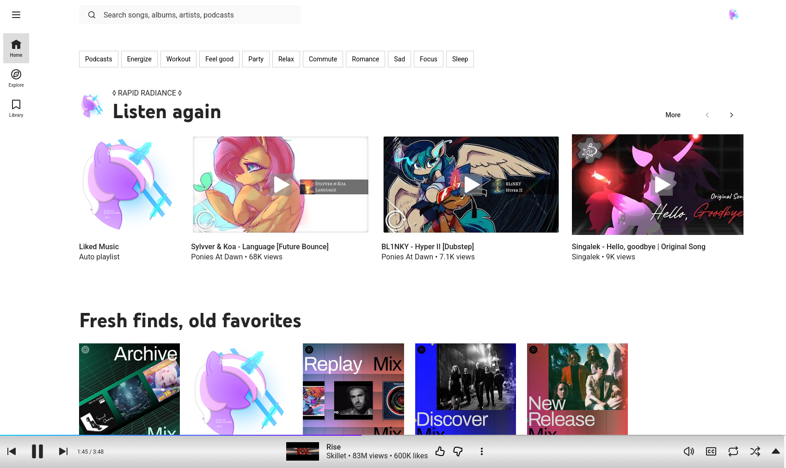
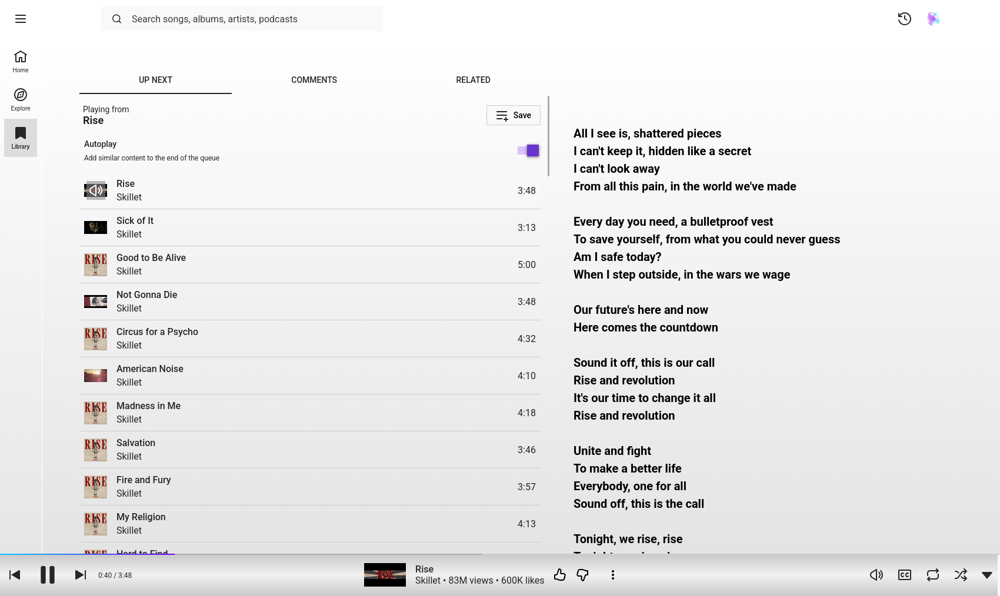

<h1 align="center">Light Theme for YouTube Music Fixes + Custom Theme</h1>

this fork includes [a css file](https://github.com/rapidradiance/Light-Theme-for-YouTube-Music-Custom/raw/refs/heads/main/fixes-and-custom-theme.css) with fixes and my own custom theme, it should be loaded after the other theme.

there is also an [optional violentmonkey script](https://github.com/rapidradiance/Light-Theme-for-YouTube-Music-Custom/raw/refs/heads/main/ytm-lyrics-beside-queue.js) that puts the lyrics next to the play queue

The theme also includes a couple options, incase you don't like some of what it does (like removing the video, or adding the gradients)

there is also a dark mode version for anyone who wants it, it should ofc be installed **without** the light mode theme file

  
  

